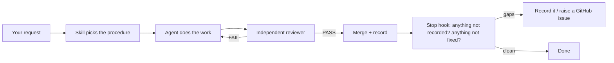

# ycm-harness

Skills, hooks and a small CLI that keep coding agents honest over long, multi-step work.

Status: **0.3 lean kernel** (experimental). Repository:
[`johnyuencm/ycm-harness`](https://github.com/johnyuencm/ycm-harness).



## What changes when you install it

| Without the harness | With the harness |
| ------------------- | ---------------- |
| The agent says "done" because it believes it is done | A different agent reviews the pinned commit; FAIL sends the work back |
| Findings live only in chat and vanish | The Stop hook blocks until findings are recorded and open problems are GitHub issues |
| "Fix the back button" fixes one screen | `designing-ux-mechanics` checks every screen for back, layers, loading and failure |
| Merging many branches drops newer behavior | `merge-branches-to-master` merges with a contract check and a review of the pinned head |
| Replies are long and hard to scan | Every reply follows ASD-STE100 Simplified Technical English, with pictures first |

## Core skills

Call a skill with `/name` (Claude Code), `$name` (Codex) or by asking for the task.

| Skill | Use it when | What you get |
| ----- | ----------- | ------------ |
| `commander` | A task takes more than a few steps, or you delegate | Dispatch rules, model-tier choice, verify-before-done discipline |
| `ycm-harness-work` | Long coding work across sessions | Goal → ticket → claim → submit → verify by a different run |
| `ycm-harness-work-lite` | A quick task | Implement → verify → one independent review, no state files |
| `plan-and-advance` | You want a plan first, then autonomous delivery | A self-grilled plan with decisions and edge cases, then the build |
| `designing-ux-mechanics` | A UI "feels vibe-coded": back needs many presses, layers stack, actions give no feedback | A mechanics audit plus a Playwright stress walk |
| `merge-branches-to-master` | Merge several branches or PRs | Safe merges, conflict rules, independent review of the pinned head |
| `review-past-commits` | Review what already shipped | Graded findings over a pinned range, report committed in the repo |
| `hard-problem-solving` | Attempts keep failing, or the cost is high | Evidence, root cause, 3 whys, fix plan before any edit |
| `create-github-tickets` | Turn findings into tracker items | Clear `gh` issues with context and acceptance |
| `explainer` / `eli5` | Text is hard to follow | A diagram, an HTML page or a narrated video |

## Core scripts (hooks)

The hooks install with the plugin and run on their own.

| Script | Runs on | Effect |
| ------ | ------- | ------ |
| `plugin/scripts/stop-hook.mjs` | Agent tries to stop | If the turn changed files, git or the tracker, the agent must record findings durably and raise a GitHub issue for each open problem |
| `plugin/scripts/ste-reminder-hook.mjs` | Every prompt | Repeats the ASD-STE100 output rule so it does not fade |
| `plugin/scripts/session-start-hook.mjs` | New session | Prints the active goal, ticket and next action |
| `plugin/scripts/pre-compact-hook.mjs` / `post-compact-hook.mjs` | Context compaction | Keeps a bounded resume card so work continues after compaction |
| `plugin/skills/designing-ux-mechanics/stress-walk.mjs` | You run it | Drives a live app: back stack, layers, slow network, double sends |

## Demo

### 1. The Stop hook

```bash
node scripts/demo-stop-hook.mjs
```

The script feeds the real hook two fake turns:

```text
▶ read-only turn (no check)
  agent stops normally (no output)

▶ turn that edits and pushes (check fires)
  agent is stopped and told:
  "Notes check: this turn changed files or the tracker. Before you stop, confirm that
   everything you would tell the user is recorded durably ... If you found anything that
   needs attention and is not fixed in this turn (a bug, a risk, an owner decision, a
   deferred item), raise a GitHub issue for it in the repo it belongs to (`gh issue
   create`), unless an open issue already covers it ..."
```

The hook asks once per turn. A continued turn is never asked again, so it cannot loop.
Turn it off with `YCM_NOTES_CHECK=off`.

### 2. The UX stress walk

```bash
cd plugin/skills/designing-ux-mechanics
npm i -D playwright@1.64.1      # once, where you run it
node stress-walk.mjs --self-test
```

`--self-test` runs every check against two built-in apps, `fixtures/good.html` and
`fixtures/bad.html`. Real output (trimmed):

```text
## Bad fixture
| N2 | Back (system) reaches home within 2 presses | Report sheet | FAIL | 3 press(es) |
| L1 | At most one layer over a screen             | Report sheet | FAIL | 2 layers open after {"click":"#more"} |
| D1 | No empty state before the first answer      | List         | FAIL | "#empty" visible while loading |
| M1 | No layout shift when data lands (CLS ≤ 0.1) | List         | FAIL | CLS 0.362 |
| A1 | Press shows a response within 100 ms        | Send         | FAIL | 304 ms |
| A2 | A double tap sends once                     | Send         | FAIL | 2 request(s) |
2 PASS, 10 FAIL.

## Good fixture
10 PASS, 0 FAIL.
SELF-TEST PASSED: every bad mechanic was caught and the good app passed.
```

Point it at your app with a small JSON config (see the header of `stress-walk.mjs`).
The manual items in `checklist.md` still need a person or an agent with a browser.

## Examples from real use

### Example 1: a UI pass over 11 repos

Request: *"It looks built by a vibe coder. Fix transitions, alerts, layers and the back
button."* With `designing-ux-mechanics` and `merge-branches-to-master`, each repo went
through audit → fix → browser check → PR → independent review → merge.

| Repo | Measured before | After |
| ---- | --------------- | ----- |
| Expo travel app | Double tap: 2 copies of a screen, 2 tab bars | 1 screen, 1 tab bar |
| Job board | 133 tap targets under 44 px; layout shift 0.585 | 0 under 44 px; layout shift 0.002 |
| Next.js finance app | Each filter tap added a history entry | Filters replace; Back goes Company → Search → Home |
| Course planner | 4 blocking `window.confirm()` dialogs | Confirm in place, then Undo |

The reviewers found real bugs the authors missed. For example, an Undo tap area overlapped
Dismiss, so a tap on Undo could delete. The fix went back through review before merge.

### Example 2: review that does not trust the author

```text
PR head 534beda ──► reviewer: FAIL (1 High, 3 Medium, 7 Low)
fix         cc2bac0 ──► reviewer: PASS (1 new Low)
fix         d70f79c ──► reviewer: PASS ──► merge
records: artifacts/reviews/review-pr-<n>-<sha>.md (committed)
```

The fix loop stops after 3 rounds. A round 3 FAIL goes to a human, not to a fourth guess.

### Example 3: durable goals with the CLI

```bash
ycm-harness init
ycm-harness goal create "Ship the change" --backend local
ycm-harness ticket create "Implement the change" --code-changed --acceptance "Targeted tests pass"
ycm-harness ticket start <ticket-id>
# implement, run checks
ycm-harness ticket submit <ticket-id>
ycm-harness verify run --ticket <ticket-id> --command "npm test" \
  --implementer-run <run-id> --verifier-run <different-run-id> --knowledge none
ycm-harness goal complete <goal-id>
```

Verification binds to the submitted state. A verifier run equal to the implementer run
does not close the ticket.

## Quick start

```bash
git clone https://github.com/johnyuencm/ycm-harness ycm-harness
cd ycm-harness
npm install && npm run build && npm link
ycm-harness sync          # install skills and hooks into Cursor, Codex, OpenCode, Claude Code
ycm-harness doctor        # check the install
npm run commander:install
npm run commander:overlay -- --force
```

Node.js 20 or later. For a hands-off setup, paste the agent prompt in
[`docs/reference.md`](docs/reference.md#paste-this-to-an-agent) into your agent.

## All skills

- `plugin/skills/commander/` — delegation protocol; guides in `plugin/commander-system/system/`.
- `plugin/skills/ycm-harness-design/` — turn a goal into a bounded goal and implementation-ready tickets.
- `plugin/skills/ycm-harness-work/` — goals, tickets, checkpoints, submitted-state verification.
- `plugin/skills/ycm-harness-work-lite/` — implement → verify → review for quick tasks.
- `plugin/skills/plan-and-advance/` — plan with self-grill, then deliver without interviews.
- `plugin/skills/designing-ux-mechanics/` — app mechanics audit and stress walk.
- `plugin/skills/merge-branches-to-master/` — safe merges with review of the pinned head.
- `plugin/skills/review-past-commits/` — review landed work over a pinned range.
- `plugin/skills/hard-problem-solving/` — evidence-first root-cause work.
- `plugin/skills/create-github-tickets/` — well-scoped GitHub issues via `gh`.
- `plugin/skills/pull-tickets/` — pull the top ready issues and implement them.
- `plugin/skills/run-technical-design-discussion/` — evidence-grounded architecture discussion.
- `plugin/skills/summarizing-goal-achievement/` — closing report for a finished goal.
- `plugin/skills/llm-wiki/` — compounding project wiki.
- `plugin/skills/explainer/` — pick the clearest format: text, diagram, HTML page or video.
- `plugin/skills/eli5/` — explain to a beginner with big pictures.
- `plugin/skills/autonomous-harness/` — autonomy baseline: durable follow-ups, bounded authority.
- `plugin/skills/create-skill/` — author a portable skill.
- `plugin/skills/integrating-google-adsense/` — AdSense loader, ads.txt, CSP.
- `plugin/skills/migrate-multica-to-github-projects/` — move Multica tickets to GitHub Projects.

Companion packs (not bundled; `ycm-harness doctor` audits them): mattpocock-skills,
ralph-loop, ponytail. See [`docs/reference.md`](docs/reference.md#recommended-vendor-plugins).

## Commander

`plugin/commander-system/` is the only source of the commander protocol. It ships in the
plugin and updates with it. Do not copy protocol files to `~/.agents/system/`; that
folder keeps only the `LESSONS.md` machine journal.

## More

- [`docs/reference.md`](docs/reference.md) — install variants, Claude Code marketplace, hooks, wiki, review panel, state layout.
- [`docs/workflow-doctrine.md`](docs/workflow-doctrine.md) — the full workflow doctrine.
- [`CONTRIBUTING.md`](CONTRIBUTING.md) — development and tests (`npm test`, `npm run typecheck`).

## License

MIT.
